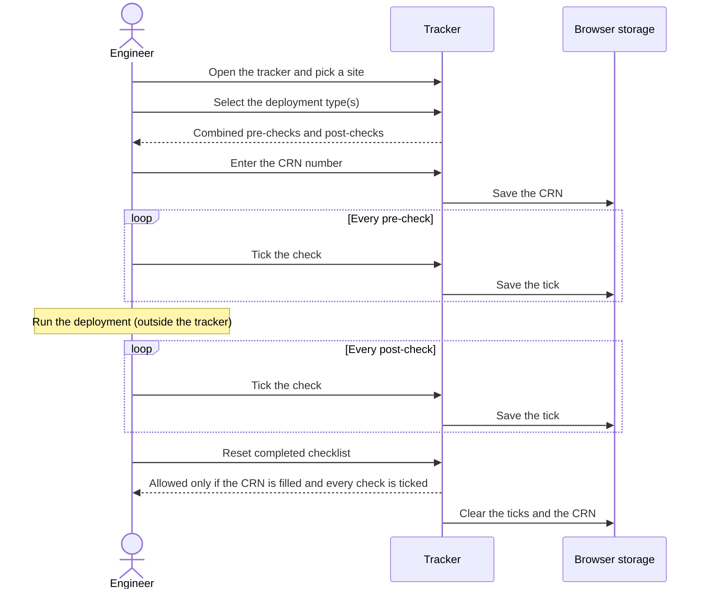
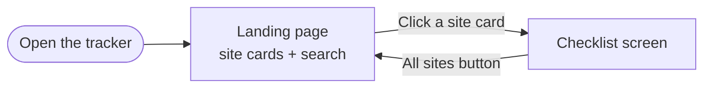
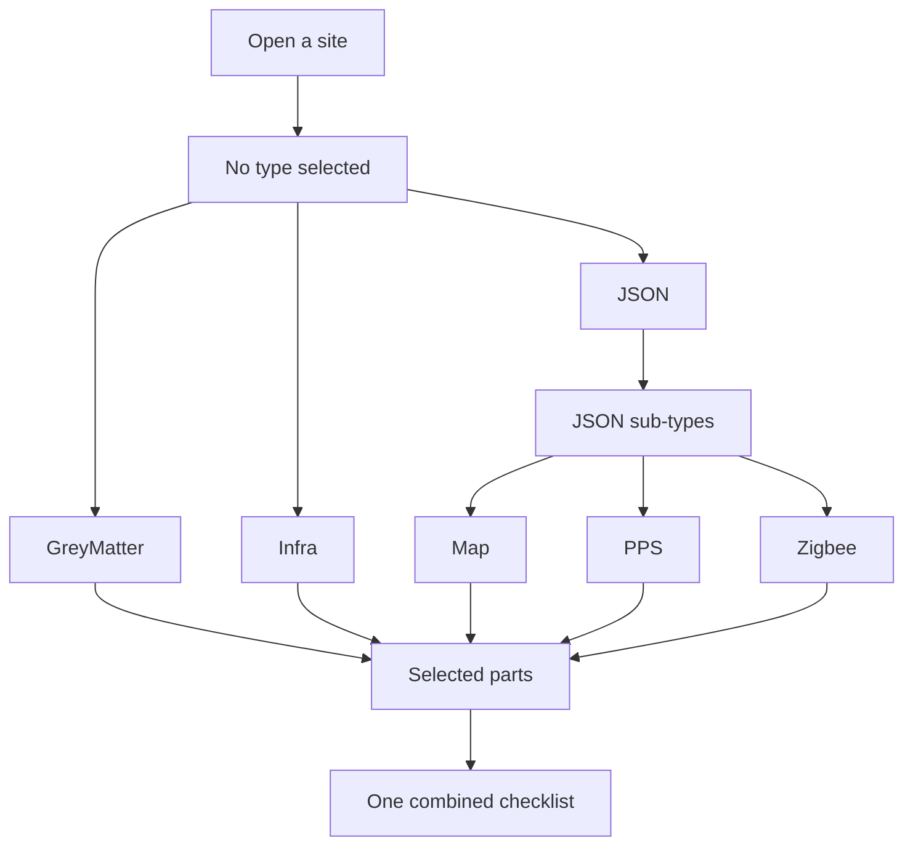
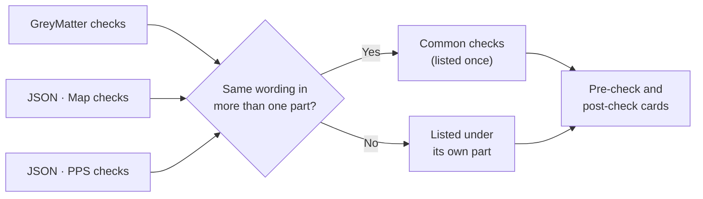
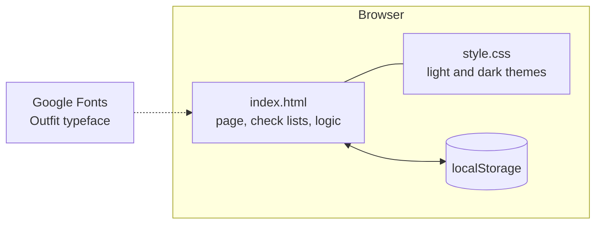

# Site Deployment Checks

A lightweight tracker for running **pre-deployment** and **post-deployment** checks at GreyOrange sites. Pick a site, choose what is being deployed, and work through one combined checklist tied to a CRN number.

It is a plain website: two files, no build step, nothing to install.

| Landing page (dark) | Checklist (light) |
| :---: | :---: |
|  |  |

**Contents:** [Features](#features) · [Quick start](#quick-start) · [How it works](#how-it-works) · [Where data is stored](#where-data-is-stored) · [Customising](#customising) · [Deploying](#deploying) · [Known limits](#known-limits) · [Ideas](#ideas-not-built-yet)

---

## Features

- **Site cards** with search, so you can jump straight to a site.
- **Deployment types:** GreyMatter, JSON and Infra. JSON has its own sub-types: Map, PPS and Zigbee.
- **Select several at once.** The checklist combines them, and checks with the same wording are shown once under **Common checks**.
- **Pre-checks and post-checks** side by side, each with a progress bar and a `done / total` count.
- **CRN number** for the deployment you are working on.
- **Guarded reset:** the checklist can only be reset when the CRN is filled in and every check is ticked.
- **Add check:** add your own pre- or post-check to a site. Remove it again with the red ✕.
- **Light and dark mode** with a toggle, remembered between visits.
- Works on phones: the two cards stack on narrow screens.

---

## Quick start

1. Download or clone the repository.
2. Open `index.html` in a browser. That is all.

While editing in VS Code, the **Live Server** extension refreshes the page every time you save.

```text
site-checklist-tracker/
├── index.html      page markup, the check lists and all the logic
├── style.css       light and dark themes
├── README.md
└── docs/           screenshots used in this README
```

---

## How it works

### A typical deployment



### Moving between screens



On the checklist screen nothing is selected when you open a site, so you always choose the deployment type yourself. The sun/moon button in the header switches between light and dark mode on any screen.

### Choosing what is being deployed

Each selected type or sub-type is called a **part**. You can select any mix of parts.



JSON itself is not a part. Pick at least one of Map, PPS or Zigbee to see its checks. Until you do, the page asks you to choose a JSON type.

### How the combined checklist is built



- A merged check is a single tick. Ticking it covers every part that shares it, and it counts once in the progress total.
- Wording is compared ignoring capital letters and punctuation. "Backup current JSON files" and "Backup current JSON files." are the same check, but "Back up the JSON files" is a different one.
- With only one part selected there are no section headings.

### When Reset is allowed


Reset only affects the current selection of parts on the current site. It never removes checks you added.

---

## Where data is stored

Everything is saved in your own browser (`localStorage`). There is no server and no account.



| Key | What it holds | Scoped to |
| --- | --- | --- |
| `siteChecks` | Which checks are ticked | Site + selected parts |
| `siteChecksTicket` | The CRN number | Site + selected parts |
| `siteChecksExtra` | Checks added with **Add check** | Site + part |
| `siteTheme` | `light` or `dark` | The browser |

Each combination of parts keeps its own ticks and CRN. Ticking something under GreyMatter + Map does not tick it under GreyMatter alone.

---

## Customising

All the content is at the top of the `<script>` in `index.html`.

```js
var SITES = ["Walmart Mexico", "H&M Canada", "Sam's ATL"];
var TYPES = ["GreyMatter", "JSON", "Infra"];

var CHECKS = {
  "Site name": {
    GreyMatter: { pre: ["First pre-check"], post: ["First post-check"] },
    JSON:       { pre: ["..."],             post: ["..."] },   // shared by every JSON sub-type
    Infra:      { pre: ["..."],             post: ["..."] }
  }
};

var SUBTYPES = {
  JSON: {
    Map:    { pre: ["..."], post: ["..."] },
    PPS:    { pre: ["..."], post: ["..."] },
    Zigbee: { pre: ["..."], post: ["..."] }
  }
};
```

| To do this | Change |
| --- | --- |
| Add a site | Add its name to `SITES` **and** add a block for it in `CHECKS` |
| Add or edit a check | Edit the `pre` / `post` lists in `CHECKS` or `SUBTYPES` |
| Add a JSON sub-type | Add an entry under `SUBTYPES.JSON` |
| Change colors | Edit the variables at the top of `style.css` (dark theme in `:root`, light overrides in `:root[data-theme="light"]`) |

Tip: if two parts should share a check, write it with exactly the same wording and the tracker merges it automatically.

---

## Deploying

The site is static, so any static host works. For Vercel:

1. Push `index.html`, `style.css`, `README.md` and the `docs/` folder to GitHub.
2. In Vercel choose **Add New → Project** and import the repository.
3. Leave the framework as **Other** and the build settings empty, then **Deploy**.

Every push to the main branch redeploys automatically. Because the browser storage belongs to the site's address, a new address starts with empty ticks.

---

## Known limits

- **Data is per browser.** Ticks, CRNs and added checks are not shared between people or devices.
- **Some sites have no checks yet.** DHL Figs, Apotek, Ryder Maryland and Aritizia-Canada are listed but have no entry in `CHECKS`, so their checklist opens empty.
- **Sample content.** The Map, PPS and Zigbee checks, and the lists for sites other than H&M Canada GreyMatter, are examples to replace with the real ones.
- **Merging needs matching wording** (see above).
- **Fonts need internet.** Without it the page falls back to the system font and looks the same otherwise.

---

## Ideas not built yet

- Shared storage, so a team sees the same ticks and CRNs (for example a Google Sheet or a small database).
- Loading the check lists from a Google Sheet instead of the code.
- An activity log of who added, removed or ticked what, and when.
- Posting "Pre-checks complete" and "Post-checks complete" to Slack or a Salesforce case.
- An approval step before a new check joins the list.
