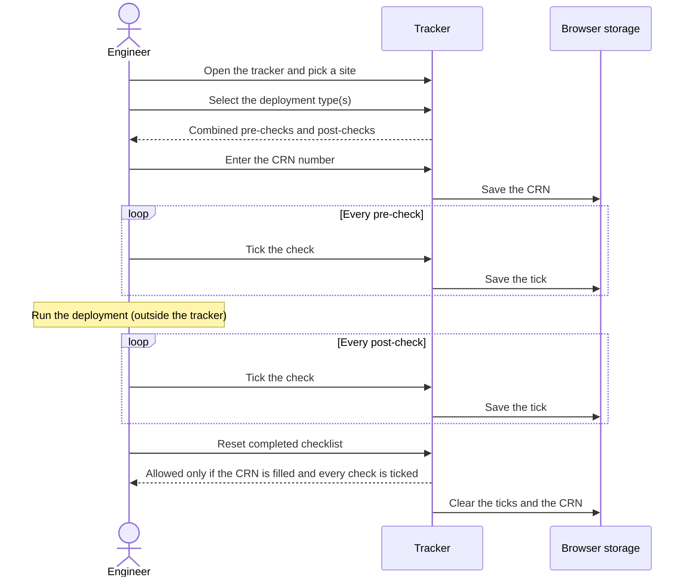
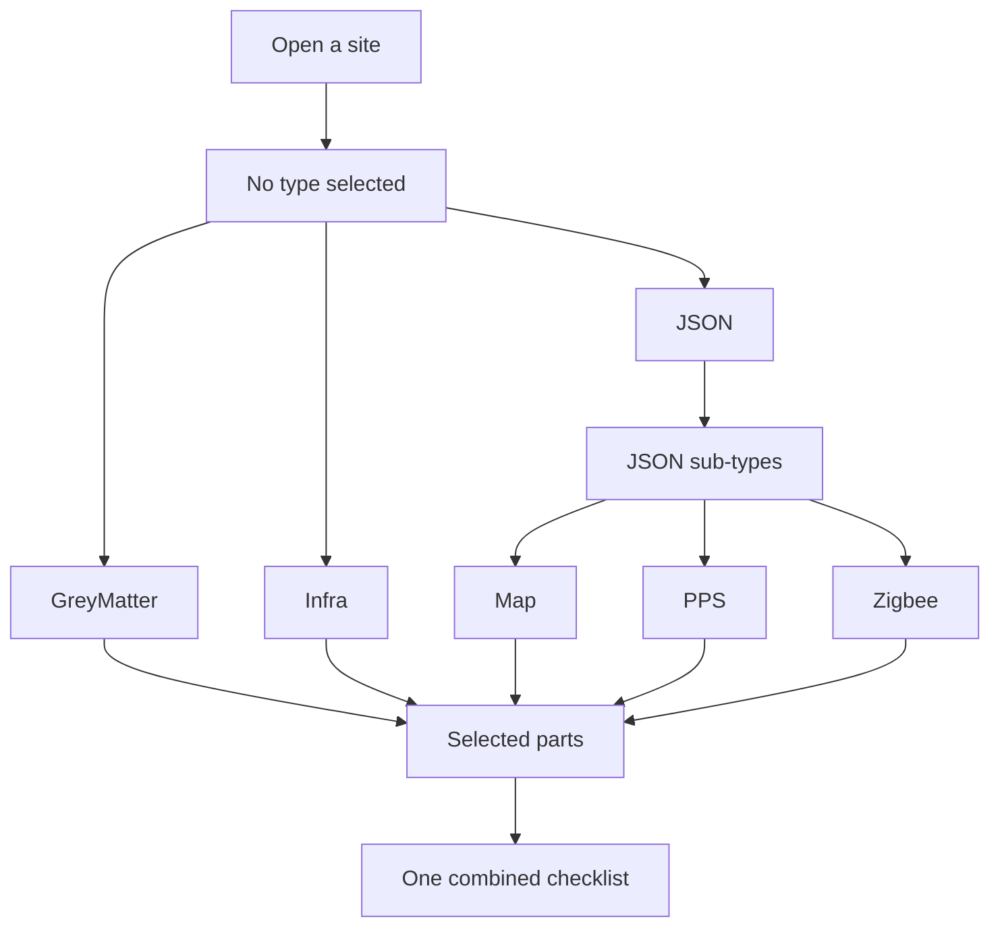
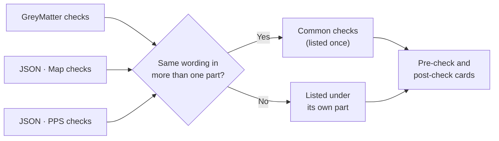
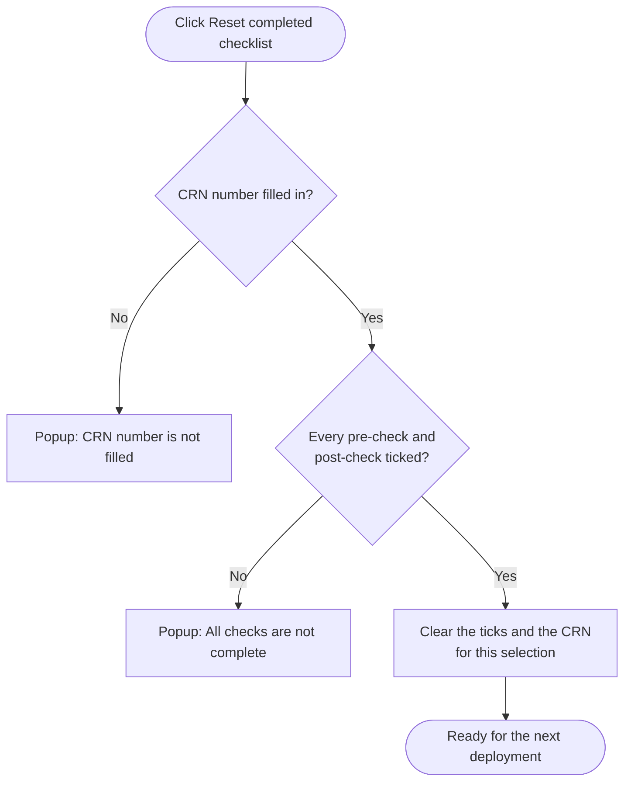
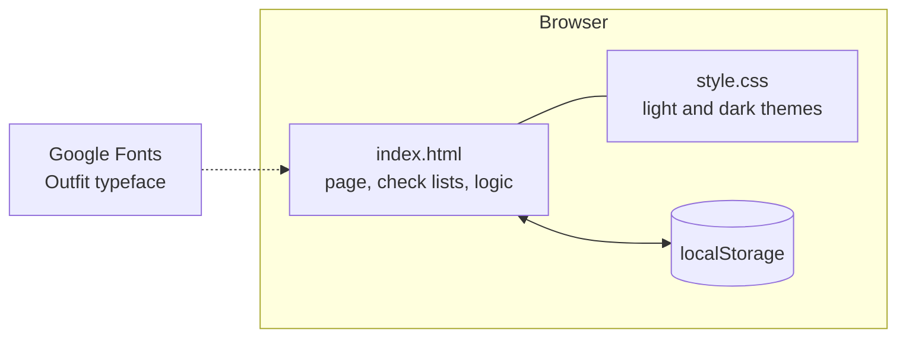

# Site Deployment Checks

A lightweight tracker for running **pre-deployment** and **post-deployment** checks at GreyOrange sites. Pick a site, choose what is being deployed, and work through one combined checklist tied to a CRN number.

---

## How it works

### A typical deployment

### Moving between screens

### Choosing what is being deployed

Each selected type or sub-type is called a **part**. You can select any mix of parts.

JSON itself is not a part. Pick at least one of Map, PPS or Zigbee to see its checks. Until you do, the page asks you to choose a JSON type.

### How the combined checklist is built

- A merged check is a single tick. Ticking it covers every part that shares it, and it counts once in the progress total.
- Wording is compared ignoring capital letters and punctuation. "Backup current JSON files" and "Backup current JSON files." are the same check, but "Back up the JSON files" is a different one.
- With only one part selected there are no section headings.

### When Reset is allowed

Reset only affects the current selection of parts on the current site. It never removes checks you added.

---

## Where data is stored

Everything is saved in your own browser (`localStorage`). There is no server and no account.

